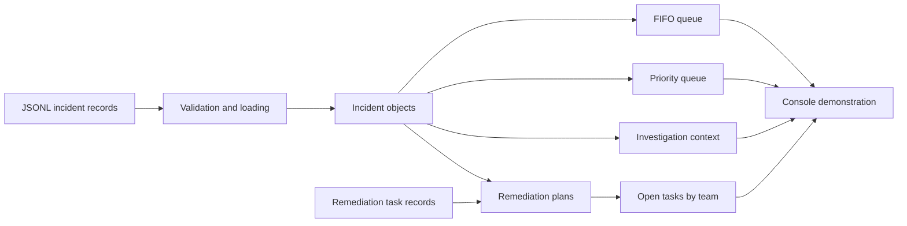

# SOC Case Manager

[](https://www.python.org/)
[](https://github.com/asaf0505-svg/SOC-Incident-Response-Manager/actions/workflows/tests.yml)
[](#technology)

A local Python application for managing, prioritizing, and reporting on Security Operations Center (SOC) incidents. The project models a practical incident-response workflow: it loads security cases from JSONL records, validates them, prioritizes urgent incidents, tracks investigation activity, and reports open remediation work by team.

This repository was developed as a four-person academic team project focused on advanced Python and object-oriented design.

## Highlights

- Models incidents, investigation actions, security events, remediation plans, and tasks.
- Prioritizes cases using both FIFO and severity-based priority queues.
- Validates JSONL records and safely skips malformed or duplicate data.
- Uses inheritance and polymorphism to calculate event risk.
- Provides lazy generators and independent custom iterators.
- Restores incident state when an investigation context exits with an error.
- Produces severity summaries and open-task workload reports.
- Includes an automated test suite covering the main business rules and edge cases.

## Example workflow



## Core design

| Area | Implementation |
| --- | --- |
| Domain model | `Incident`, `SecurityEvent`, `InvestigationAction`, `RemediationPlan`, and `Task` |
| OOP | Abstract base class, inheritance, composition, properties, and alternative constructors |
| Prioritization | `deque` for FIFO and `heapq` for severity-based processing |
| Fast lookup | Dictionary index by incident ID |
| Data processing | List, dictionary, and set comprehensions plus multi-field sorting |
| Lazy evaluation | Generators and a three-stage lazy pipeline |
| Safe state changes | Custom context manager with rollback on exceptions |
| Persistence input | Line-by-line JSONL loading with validation and duplicate detection |

## Project structure

```text
SOC-Incident-Response-Manager/
├── data/
│   ├── sample_data.jsonl          # Synthetic incident records
│   └── remediation_tasks.jsonl    # Synthetic remediation tasks
├── docs/
│   └── assignment-notes-he.md     # Original Hebrew academic documentation
├── soc_case_manager/
│   ├── context_managers.py        # Investigation lifecycle and rollback
│   ├── iterators.py               # Custom iterator and lazy generators
│   ├── models.py                  # Domain classes and validation
│   ├── processing.py              # Queues, indexing, filtering, and sorting
│   ├── reports.py                 # Remediation plans and workload reports
│   └── repository.py              # JSONL incident loader
├── tests/
│   └── test_project.py            # Automated unit and integration tests
├── AI_USAGE.md                    # AI-use documentation for the course
├── main.py                        # End-to-end console demonstration
└── pyproject.toml                 # Project metadata
```

## Getting started

### Requirements

- Python 3.9 or newer
- No external runtime dependencies

### Run the demonstration

```bash
git clone https://github.com/asaf0505-svg/SOC-Incident-Response-Manager.git
cd SOC-Incident-Response-Manager
python main.py
```

On Windows, use `py main.py` if `python` is not available as a command.

The demonstration loads the sample data and prints the complete flow: validation, prioritization, iteration, risk calculation, safe investigation state changes, task completion, and workload reporting.

## Run the tests

```bash
python -m unittest discover -s tests -v
```

The test suite covers:

- Invalid records and duplicate IDs
- Incident and task validation
- FIFO and priority queue ordering
- Inheritance-based risk calculation
- Independent iterators and lazy generators
- Context-manager success and rollback behavior
- Remediation loading and workload reports
- End-to-end execution of `main.py`

The same test command runs automatically on GitHub Actions for every push and pull request.

## Data and security notes

- All records in `data/` are synthetic examples for demonstration purposes.
- The application runs locally and does not connect to a real SIEM or production environment.
- Invalid or incomplete JSONL records are reported and skipped instead of stopping the process.
- State changes are kept in memory; persistent storage is a possible future extension.

## Technology

- Python 3.9+
- Python standard library
- `unittest`
- JSON Lines (JSONL)
- GitHub Actions

## Future improvements

- Connect to a SIEM ingestion API.
- Persist incident and remediation updates in a database.
- Add authentication and analyst roles.
- Provide a web dashboard for case triage and reporting.

## Documentation

- [Original course documentation (Hebrew)](docs/assignment-notes-he.md)
- [AI usage documentation](AI_USAGE.md)

